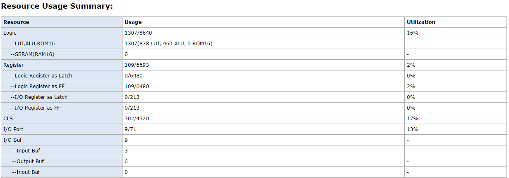
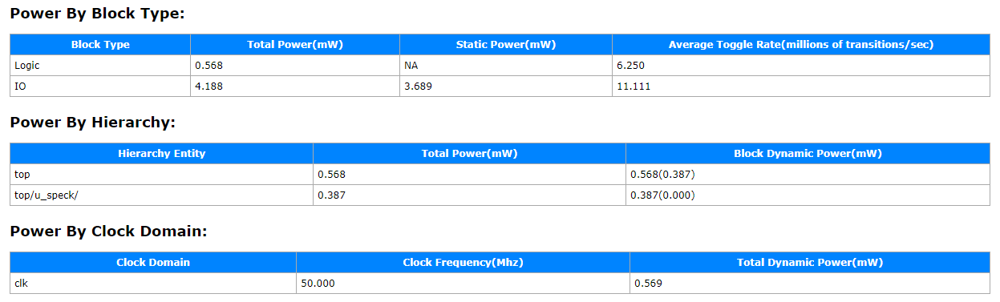
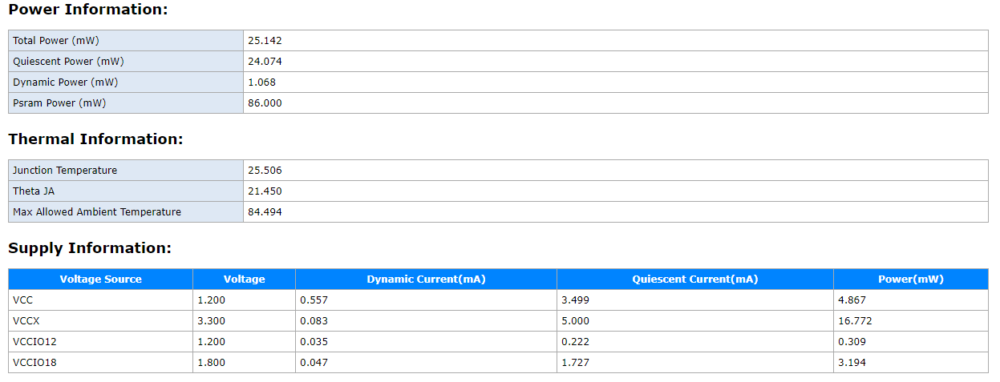
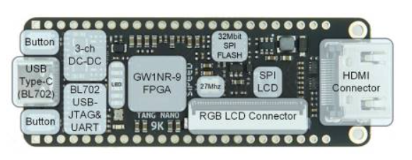
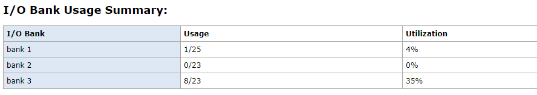
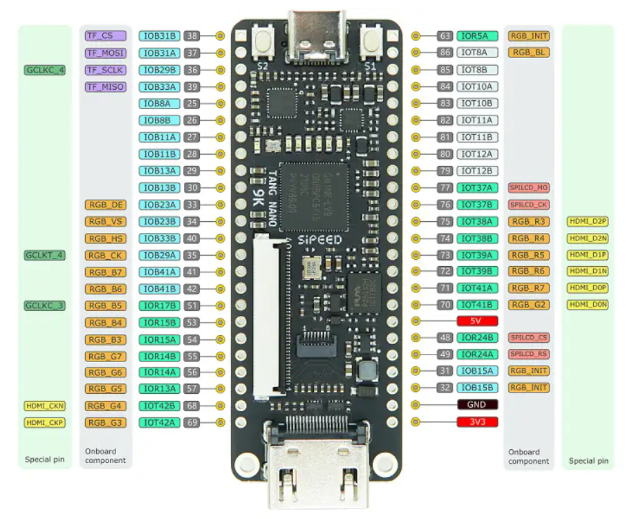

# SIMON & SPECK Cryptographic Cores on Tang Nano 9K

Lightweight **SIMON32/64** and **SPECK32/64** block cipher cores implemented in Verilog HDL on the **Sipeed Tang Nano 9K** FPGA.

Designed for secure embedded applications with low area and power consumption.

---

## Project Highlights

- Full hardware implementation of SIMON32/64 and SPECK32/64
- Operating frequency: **50 MHz**
- Maximum frequency (Fmax): **87.10 MHz**
- Zero timing violations
- LUT usage: **16%**
- Total power consumption: **25.14 mW**
- Interactive demo using onboard buttons and LEDs

---

## About the Algorithms

**SIMON** and **SPECK** are lightweight block ciphers designed by the NSA for constrained environments (IoT, embedded systems, RFID, etc.).

| Cipher     | Block Size | Key Size | Rounds |
|------------|------------|----------|--------|
| SIMON32/64 | 32-bit     | 64-bit   | 32     |
| SPECK32/64 | 32-bit     | 64-bit   | 22     |

Both ciphers are implemented as pure combinational + sequential RTL cores.

---

## Design Overview

### Modules

| File              | Description                          |
|-------------------|--------------------------------------|
| `simon.v`         | SIMON32/64 encryption core           |
| `speck.v`         | SPECK32/64 encryption core           |
| `top.v`           | Top-level module with button control |
| `constraints.cst` | Pin constraints for Tang Nano 9K     |

### Features of Top Module
- Button 0 → Increment plaintext
- Button 1 → Switch between SIMON / SPECK mode
- LEDs display lower bits of ciphertext + current mode

---

## Implementation Results

### Resource Utilization

### Timing / Frequency

- Target Frequency: 50 MHz
- Achieved Fmax: **87.10 MHz**
- Zero timing violations

### Power Consumption

- Total Power: **25.14 mW**

### Board Resources

---

## How to Use

1. Open the project in **GOWIN FPGA Designer**
2. Add the files from the `rtl/` folder
3. Use the provided `constraints.cst`
4. Synthesize → Place & Route → Generate Bitstream
5. Program the Tang Nano 9K

---

## Tools Used

- **FPGA Board**: Sipeed Tang Nano 9K (Gowin GW1NR-9)
- **HDL**: Verilog
- **IDE**: GOWIN FPGA Designer / GOWIN EDA

---

## Author

**Bejish S**  
VLSI Design & Technology  
Chennai Institute of Technology  

[GitHub](https://github.com/bejish)
